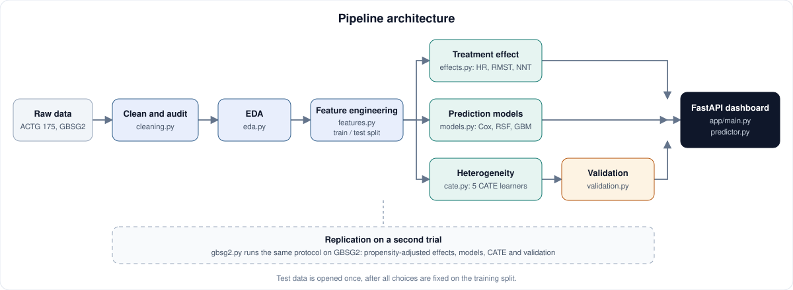
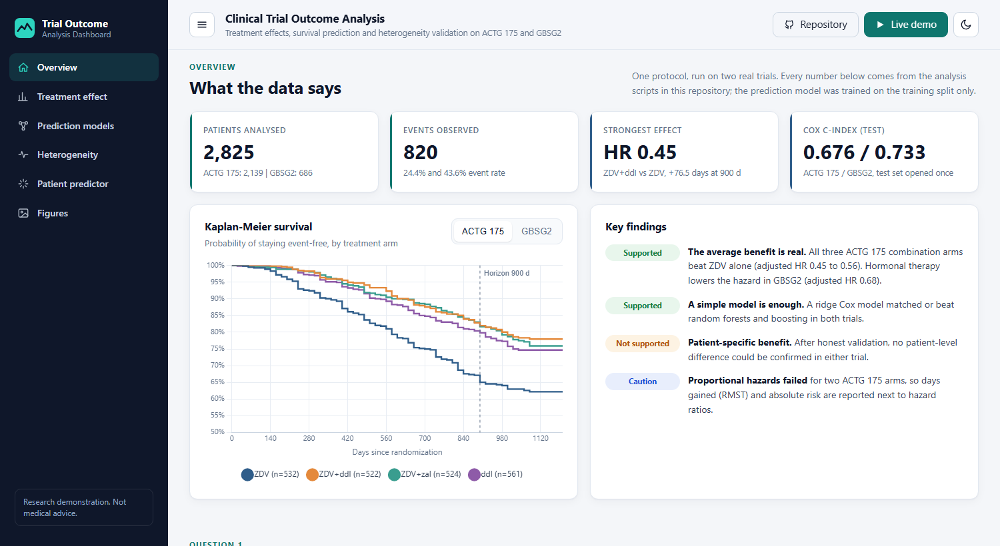
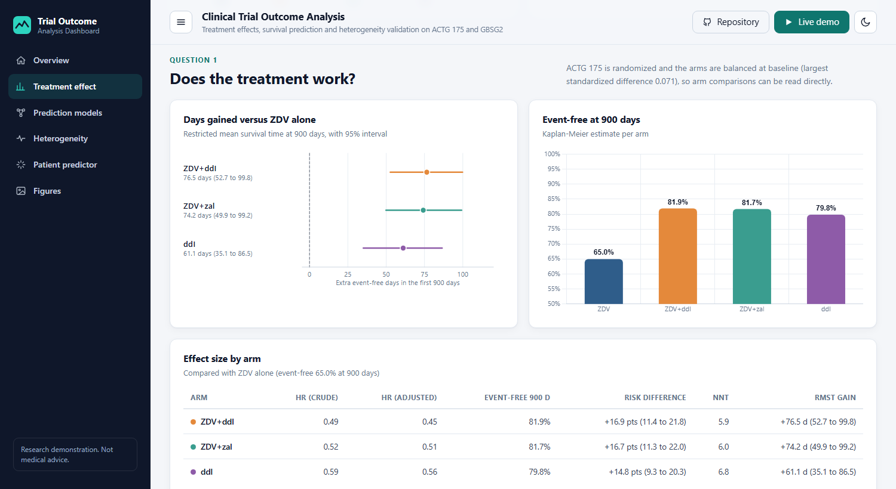
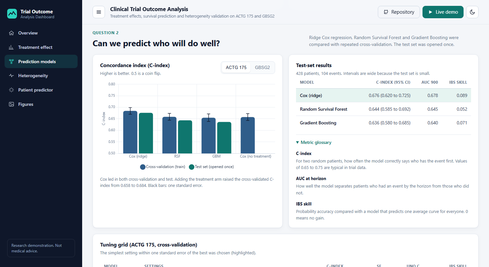
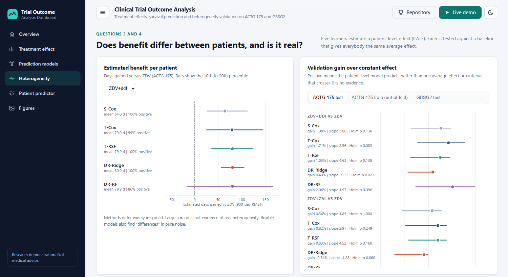
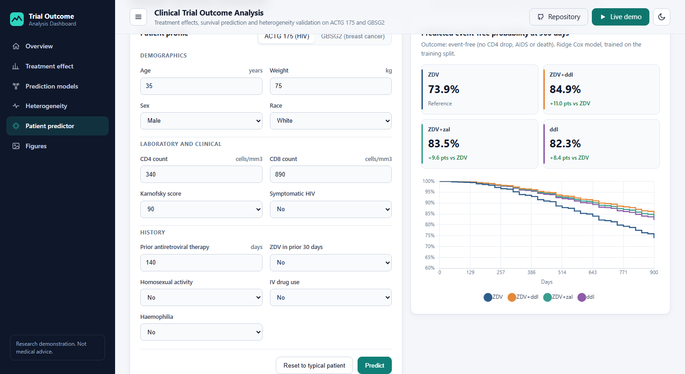

# Clinical Trial Outcome Analysis

## 🔭 Overview

Clinical trials usually report one number: the **average** effect of a treatment. This project goes further, on
**time-to-event (survival) data with censoring**, and answers four connected questions with one consistent protocol:

1. **Does the treatment work?** Kaplan-Meier curves, Cox hazard ratios, restricted mean survival time (RMST), NNT and
   covariate-adjusted estimates.
2. **Can we predict who will do well?** Cox regression versus Random Survival Forest versus Gradient Boosting,
   compared with cross-validation and a test set that is opened exactly once.
3. **Does the benefit differ from patient to patient?** Patient-level effect estimates (CATE) from five learners.
4. **Is that difference real or just noise?** A dedicated validation stage with a constant-effect baseline,
   calibration slope, global-null permutation test and out-of-sample test.

The same protocol is run on two trials, **ACTG 175** (HIV, four treatment arms) and **GBSG2** (breast cancer,
hormonal therapy), so conclusions are not tied to a single dataset.

The results are served through an interactive **FastAPI dashboard** that also contains a patient-level **survival prediction tool** (see [Dashboard](#-dashboard)).

---

## 🎯 Aim and research questions

**Aim:** build and document an end-to-end, leakage-safe analysis that separates what the data can truly support
(average benefit, outcome prediction) from what it cannot yet support (patient-specific benefit), and show that it
behaves consistently across two trials.

| # | Research question |
|---|---|
| RQ1 | How large is the treatment effect, in hazard ratio, days gained (RMST) and absolute risk? |
| RQ2 | Does machine learning predict outcomes better than a regularized Cox model? |
| RQ3 | Do estimated patient-level effects (CATE) capture real heterogeneity? |
| RQ4 | Do the conclusions replicate on a second trial with a different design? |

---

## ❓ Problem statement

| Challenge | Why it matters |
|---|---|
| **Average effect hides individuals** | A drug that helps on average may help some patients much more, or not at all. Clinicians want to know *who* benefits. |
| **Censoring** | Many patients leave follow-up before an event happens. Ordinary regression and plain percentages are biased on such data. |
| **Data leakage** | Using variables measured after randomization, or fitting preprocessing on the full dataset, quietly inflates results. |
| **False discoveries in "personalized medicine"** | Flexible ML models can find patient-level differences in pure noise, and many reports skip honest validation. |
| **Trials are not always cleanly randomized** | In GBSG2 the treated and untreated groups differ at baseline, so a naive comparison would mislead. |

---

## ✨ Key features

- **Leakage-safe by construction:** the train/test split comes first; scaling, encoding and model settings are
  learned on training data only; post-randomization variables are removed.
- **Censoring-aware throughout:** Kaplan-Meier, Cox, RMST, IPCW outcomes, integrated Brier score, Uno's C-index.
- **Five heterogeneity learners:** S-Cox, T-Cox, T-RSF and two doubly-robust learners (DR-Ridge, DR-RF), all
  out-of-fold (cross-fitted).
- **Honest validation:** constant-effect baseline, calibration slope with robust intervals, tertile calibration,
  a global-null permutation test, and a test set opened once.
- **Confounding-aware:** propensity-score (AIPW) analysis for the non-randomized GBSG2 comparison.
- **Simplicity preferred:** among settings within one standard error of the best, the simplest is chosen.
- **Readable output:** every script prints plain-language explanations and saves figures and tables.
- **Single-command stages:** each stage is one script with a `--fast` mode for quick checks.
- **Prediction system:** two ridge Cox models (one per trial) turn baseline measurements into the predicted probability of staying event-free at the trial horizon, under each treatment option.
- **FastAPI dashboard:** results, interactive charts, a patient predictor and a figure gallery in one professional web interface, backed by a documented JSON API.

---

## 🏗 Architecture

<p align="center">
  
</p>

| Stage | Script | What it does | Main outputs |
|---|---|---|---|
| Clean and audit | `src/cleaning.py` | Missing-value audit, removal of ID and post-randomization columns, linearity and outlier checks | `data/processed/actg175_clean.csv` |
| EDA | `src/eda.py` | Outcome, distributions, baseline balance, censoring by arm, Kaplan-Meier, correlations, patterns, one-page summary | `results/figures/eda_*.png`, `results/eda_summary.txt` |
| Feature engineering | `src/features.py` | Stratified train/test split, encoding, VIF check, transform and scaling chosen by cross-validation | `data/processed/X_*`, `y_*`, `treatment_*` |
| Treatment effect | `src/effects.py` | Kaplan-Meier, Cox hazard ratios, proportional-hazards check, RMST, NNT with bootstrap intervals | `results/figures/effects_1_summary.png` |
| Prediction | `src/models.py` | Cox vs RSF vs GBM, small tuning grids, cross-validation, one-time test evaluation | `results/figures/models_1_comparison.png` |
| Heterogeneity | `src/cate.py` | Five CATE learners with cross-fitting | `data/processed/cate_*.csv` |
| Validation | `src/validation.py` | Constant-effect baseline, calibration slope, global null, test check | `results/figures/validation_1_summary.png` |
| Replication | `src/gbsg2.py` | The whole protocol on GBSG2 with propensity-adjusted effects | `results/figures/gbsg2_*.png` |

---

## 🖥 Dashboard

<p align="center">
  <!-- TODO: replace # with the live demo URL after publishing to GitHub (also set live_demo_url in config.yaml) -->
  <a href="#"></a>
</p>

A single-page web dashboard built with **FastAPI** (backend) and plain HTML, CSS and JavaScript (frontend). It reads the
tables produced by the analysis scripts and adds a prediction endpoint. It supports light and dark themes and works on phones.

<p align="center">
  
</p>
<p align="center">
  
  
</p>
<p align="center">
  
  
</p>

| Page | What it shows |
|---|---|
| Overview | Headline numbers, Kaplan-Meier curves for both trials, key findings |
| Treatment effect | Days gained (RMST) with intervals, event-free percentages, hazard ratios, NNT, subgroup forest plot |
| Prediction models | Cox vs Random Survival Forest vs Gradient Boosting: cross-validation, test set, tuning grid, metric glossary |
| Heterogeneity | Patient-level effect ranges and the validation against a constant-effect baseline, with the verdict |
| Patient predictor | Enter a patient profile (ACTG 175 or GBSG2) and get the predicted event-free probability under each treatment, with curves |
| Figures | Gallery of every plot produced by the pipeline |

### Run it

From the project folder (after the analysis scripts have produced `results/` and `data/processed/`, which are already included):

```bash
pip install -r requirements.txt
uvicorn app.main:app --reload
```

Open `http://127.0.0.1:8000`. Interactive API documentation is at `http://127.0.0.1:8000/docs`.
On the first start the prediction models are trained from the saved training split (a few seconds) and cached in `models/`.

### API

| Method and path | Returns |
|---|---|
| `GET /api/overview` | Trial sizes, events, headline effect and test C-index |
| `GET /api/km` | Kaplan-Meier curves for both trials |
| `GET /api/effects` | Treatment effect table, pairwise tests, censoring, subgroup hazard ratios |
| `GET /api/models` | Cross-validation, test and tuning results |
| `GET /api/heterogeneity` | CATE summaries and validation results |
| `POST /api/predict/actg175` | Predicted event-free probability at 900 days for the four arms |
| `POST /api/predict/gbsg2` | Predicted recurrence-free probability at 1,460 days with and without hormonal therapy |

Example:

```bash
curl -X POST http://127.0.0.1:8000/api/predict/actg175 -H "Content-Type: application/json" \
     -d '{"age": 35, "cd40": 340, "cd80": 890, "karnof": 90}'
```

> **Prediction is a research demonstration.** The models are trained on public teaching copies of two trials.
> The treatment difference shown for one patient is the model estimate only, because the validation stage found no
> reliable evidence of patient-level treatment differences. It is not clinical decision support.

---

## 💡 Benefits

- **For researchers and biostatisticians:** a transparent, reusable template for survival analysis with honest
  evaluation, ready to run on any two-group or multi-arm trial with a time-to-event outcome.
- **For clinical machine-learning work:** a concrete demonstration that a flexible model is not automatically better
  than a regularized Cox model, and a method for checking whether "personalized" effects are real.
- **For decision making:** results are reported in units clinicians understand (event-free percentage, days gained,
  NNT), with intervals, not only hazard ratios.
- **For reviewers and collaborators:** every choice is documented, every script is runnable, and every figure and
  table can be regenerated.
- **For avoiding false claims:** the validation stage protects against reporting patient-level differences that are
  only noise.

---

## ✅ Conclusion

On two real trials, the pipeline gives a consistent picture. **The treatments help on average**: all three ACTG 175
combination arms cut the hazard of the primary event roughly in half compared with ZDV alone, and hormonal therapy in
GBSG2 lowers it by about a third. **Prediction is a solved-enough problem for simple models**: a regularized Cox model
matched or beat random forests and boosting. **Patient-specific benefit is not yet supported**: after a constant-effect
baseline, calibration slope, global-null test and a one-time test evaluation, no patient-level difference could be
confirmed in either trial.

The practical message is that, with data of this size, reporting a solid average effect with honest uncertainty is
better than claiming personalization the data cannot support. The same code can be pointed at larger trials, where
heterogeneity can be tested with more power.